  <b>Hi, hier ist Solo Stack.</b> 
  Ich baue eigene Apps mit AI und nehme dich auf YouTube mit: Fortschritte, Fehler, Learnings und die geschäftliche Seite dahinter.

  

### ☾ Woran ich gerade baue

- **Eigene Apps**, von der ersten Idee bis zum Release, mit AI als festem Teil des Teams
- **Den Kanal selbst**: Schnitt, Thumbnails und Veröffentlichung sollen so weit wie möglich automatisch laufen
- **Dieses Profil**: die Videoliste weiter unten pflegt eine GitHub Action ganz von allein

  

### ▶ Neueste Videos

<!-- VIDEOS:START -->

☾ Das erste Video ist in Arbeit. Sobald es online ist, erscheint es hier automatisch.

<!-- VIDEOS:END -->

### ✦ Hier findest du mich

  
  
  
  
  
  
  

  

